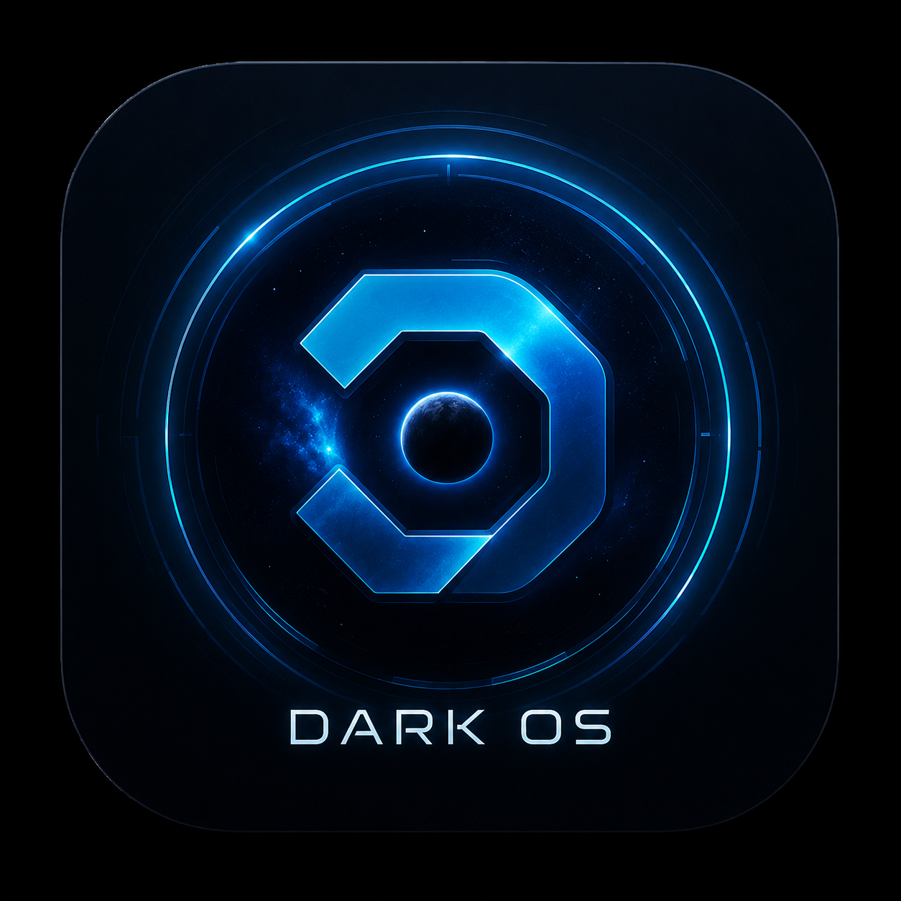
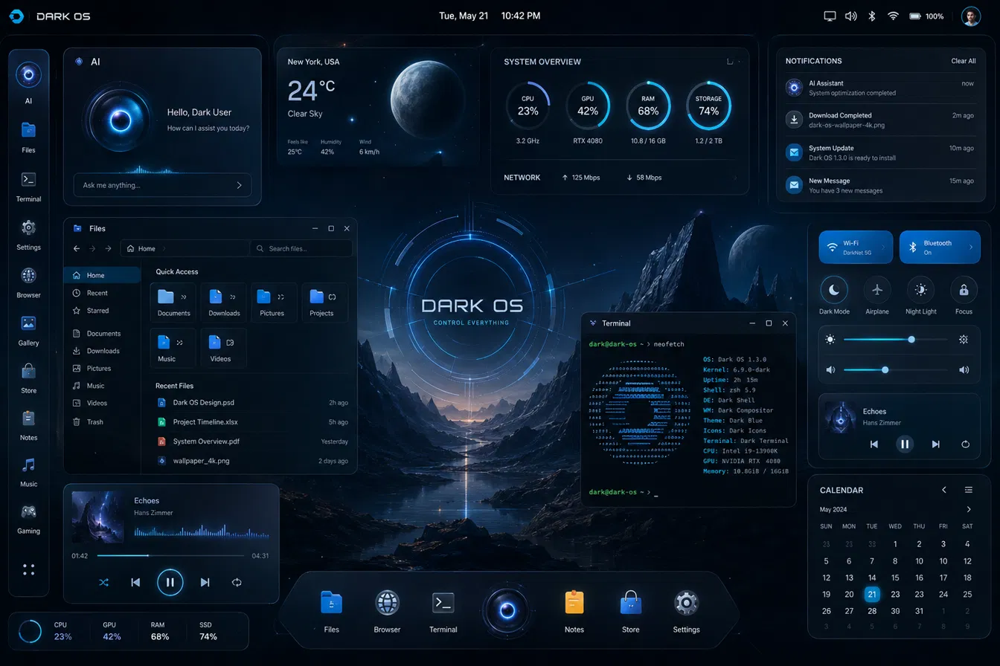

<p align="center">
  
</p>

<h1 align="center">DarkOS</h1>
<p align="center"><strong>Control Everything.</strong> An original, security-minded Linux OS.</p>

<p align="center">
  <em>Arch respin + BlackArch security tools + Hyprland compositor + cinematic glassmorphism shell</em>
</p>

---

DarkOS is a real startup product — not a demo, not a theme pack, not a Windows/macOS clone. It combines a daily-drivable Arch Linux base with a cinematic glassmorphism/HUD desktop environment and a voice assistant that can see, hear, and control the whole system.

## Features

Current status, with what is verified and what is not: [docs/STATUS.md](docs/STATUS.md).
The working plan is [docs/MASTER-PLAN.md](docs/MASTER-PLAN.md). Package declarations and
GTK startup checks are not a claim of full daily-driver or hardware acceptance.

- **Arch Linux under the hood** — rolling releases, pacman + AUR, full software ecosystem
- **BlackArch layered in** — 2,900+ security tools available as opt-in groups at install time
- **Hyprland compositor** — Wayland-native, GPU-accelerated, tiling + floating, spring animations, blur and rounded corners
- **Cinematic glassmorphism shell** — pure black backgrounds, glass panels with compositor-rendered blur, electric cyan `#00e5ff` primary, neon blue `#2d7bff` secondary
- **Fast by default** — a Lite effects profile (no blur, shadows or transparency) is the default in virtual machines; Full effects are one setting away (Settings → Performance)
- **Native and hosted app tiers** — 21 native GTK applications are implemented toward the ~27-app catalog, including Settings, Files, Terminal, Gaming Hub, and basic Mail. The hosted tier includes Firefox, mpv, Geary, GNOME Camera (`snapshot`), Kooha, Wine, Steam, Lutris, and Waydroid. Gaming Hub checks local availability before enabling its launch actions.
- **Calamares graphical installer**
- **Windows compatibility** via Wine / Bottles / Proton / QEMU/KVM

## Desktop Preview

<p align="center">
  
</p>

*Preview of the previous design (top bar, floating panels, left icon rail and dock). The Calm Dark redesign has one slim top bar, one dock and one Command Center panel; see docs/STATUS.md.*

## Quick Start

### Build the ISO

The native build requires `archiso` and `mkinitcpio` on Arch Linux:

```bash
git clone https://github.com/Darkness0258/Dark-OS.git
cd Dark-OS
sudo bash build-iso.sh
```

On Windows, run Docker Desktop in Linux-container mode. From PowerShell in the
repository root, build and run the privileged Arch builder with:

```powershell
Set-Location 'D:\Projects\Dark OS'
docker compose run --rm --build darkos
```

Compose bind-mounts the repository at `/workspace`. The builder image supplies
ArchISO dependencies; `ci/docker-build-iso.sh` stages the current source on a
Linux filesystem so Windows' synthetic file modes cannot break permission
checks. It seeds repository trust, builds and verifies the ISO, then publishes
the verified images back to `out/`. To retain the builder's temporary work
directories for troubleshooting, add the debug override:

```powershell
docker compose -f compose.yaml -f compose.debug.yaml run --rm --build darkos
```

The debug override stores `/tmp` in a named Docker volume and sets
`DARKOS_KEEP_WORK=1`, so the reported staging, work, repository, and verification
directories remain available to a later debug container.

Output is written to `out/darkos-*.iso`.

After verification, the build also refreshes `out/darkos.iso`. This stable
path is what the VMware test machine uses, so it always points to the most
recent verified build rather than a stale installer image.

### Run in a VM

```bash
cp /usr/share/edk2/x64/OVMF_VARS.4m.fd /tmp/darkos-vars.fd
qemu-system-x86_64 -m 4096 -enable-kvm -cdrom out/darkos.iso \
  -drive if=pflash,format=raw,readonly=on,file=/usr/share/edk2/x64/OVMF_CODE.4m.fd \
  -drive if=pflash,format=raw,file=/tmp/darkos-vars.fd
```

UEFI boot only — the live ISO boots via systemd-boot. Calamares installs GRUB in the target system; `darkos-grub-repair` retries it on the first installed boot only when the verified completion marker is absent.

### Launch the Installer

On a booted live system, open **Install DarkOS** from the application menu or
run the session-aware wrapper from a terminal:

```bash
darkos-installer
```

The wrapper preserves the active Wayland session, hides the DarkOS shell
overlays while Calamares is open, and restores them when the installer exits.

## Phase 1 Verification

Phase 1 was validated with the ISO produced by
[Actions run 31371511319](https://github.com/Darkness0258/Dark-OS/actions/runs/31371511319)
from commit `e933f489` and published as release `v96`. The reconstructed ISO
has SHA-256 `CEB95BACC1AC69C783A89CB411239CBDD7AB278FEF3C83A8A09206E0CE032B25`.

- The live ISO reports `-rwxr-xr-x` for `darkos-grub-install.sh`.
- A fresh UEFI Erase-disk installation completed all 34 Calamares jobs.
- `mkinitcpio`, `grub-install`, and `grub-mkconfig` each exited with status 0.
- With the ISO disconnected, the installed disk reached the `darkos-vm` login prompt.
- `/boot/grub/install.log` ends with `repair complete; validated config and marker written`.
- The installed system's `/etc/mkinitcpio.conf` is modified at first boot by `darkos-grub-install.sh` to include the `plymouth` hook, then `mkinitcpio -P` builds the initramfs with the DarkOS splash.

## Phase 2 Verification

The shipped Phase 2 login stack and shell chrome were validated on a fresh erase-disk UEFI installation in VMware Workstation.

1. **Plymouth Boot Splash**: The DarkOS `CONTROL EVERYTHING` boot animation loads cleanly during initramfs kernel execution.
2. **ReGreet Login Display Manager**: The `greetd` + `cage` + `regreet` stack starts on boot with the default DarkOS wallpaper, session selector (Hyprland), and user authentication.
3. **Desktop Shell Chrome**: Post-login Hyprland launches the verified shell surface:
   - **Top Bar**: slim Waybar with the logo, workspaces, window title, a centred clock and status icons.
   - **Floating Dock**: an Apps button (the `Super+E` search overlay) and the pinned core applications.
   - **Command Center**: one solid panel (control icon in the bar, or `Super+H`): Wi-Fi, Bluetooth, Night Light, Focus and Airplane toggles, real volume and brightness sliders, notifications from mako with Clear all, Now Playing (only while a player runs), compact CPU / memory / disk rows and a calendar.
4. **The Void & BlackArch First-Boot Flow**: `darkos-firstboot-tools` prompts on initial desktop entry, launching the VTE-backed The Void wrapper (`darkos-terminal.py`) to execute `darkos-tool-groups`, which performs live pacman database synchronization and presents the interactive BlackArch tool group selector.

## Project Structure

```
├── airootfs/                    # Files baked into the live ISO
│   ├── etc/
│   │   ├── xdg/hypr/hyprland.conf   # Hyprland compositor config
│   │   ├── xdg/waybar/              # Waybar config + CSS
│   │   ├── calamares/               # Installer module configs
│   │   ├── fastfetch/config.jsonc   # System info display
│   │   ├── passwd, group, shadow    # Live session user (darkos, passwordless)
│   │   ├── sudoers.d/darkos         # Passwordless sudo (live session)
│   │   └── systemd/system/          # Boot services (autologin, seatd, grub-repair)
│   ├── usr/
│   │   ├── local/bin/               # the-void.sh, darkos-tty1-login, darkos-grub-install.sh
│   │   └── share/
│   │       ├── applications/the-void.desktop  # Branded terminal launcher
│   │       └── calamares/branding/darkos/     # Installer slideshow + icon
│   └── home/darkos/.bash_profile    # Auto-starts Hyprland on TTY1
├── packages.x86_64              # Packages installed in the ISO
├── pacman.conf                  # Repository configuration
├── profiledef.sh                # archiso profile metadata
├── build-iso.sh                 # Local build wrapper
├── docs/
│   ├── MASTER-PLAN.md           # The plan: phases, decisions, test manual
│   └── STATUS.md                # What is verified, what is not
├── TESTING-MANUAL.md            # Per-pass feature checks (supplements the plan's manual)
└── .github/workflows/build-iso.yml  # CI pipeline (GitHub Actions)
```

## Design System

| Token | Value | Usage |
|---|---|---|
| Primary | `#00e5ff` | Accents, brand elements, active borders |
| Secondary | `#2d7bff` | Module UI, secondary highlights |
| Background | `#000000` | Pure black base |
| Surface | `rgba(255,255,255,0.06)` | Glass panel fill |
| Body face | Inter, SF Pro Display | UI text |
| Display face | Space Grotesk | Headings, logo |
| Corner radius | 16px | Panels, dialogs |

Tokens live in [tokens.py](airootfs/usr/local/bin/darkos_shell/tokens.py); the design direction is in [docs/MASTER-PLAN.md](docs/MASTER-PLAN.md).

## Architecture

See [CLAUDE.md](CLAUDE.md) for the build invariants and [docs/MASTER-PLAN.md](docs/MASTER-PLAN.md) for the plan. Key principles:

- A single GTK3 + gtk-layer-shell shell process draws the dock and the Command Center; Waybar is the status bar
- Hosted apps (browser, media player, containers) are never modified — visual consistency comes from Hyprland's compositor-level decorations
- The AI assistant (Iras) and the HUD were removed on 2026-10-17, and nothing in the session polls for AI context. Nine wallpapers ship in `/usr/share/backgrounds/darkos/` (default: Midnight Silk); Settings > Wallpaper switches between them or takes your own image

## Roadmap

| Phase | Goal |
|---|---|
| 1 | Bootable and installable Arch + Hyprland + BlackArch ISO — historical VM verification; changed-image acceptance tracked in the audit |
| 2 | Core shell chrome implemented; current HUD/Hyprland acceptance remains open |
| 3 | AI assistant — removed (2026-10-17) |
| 4 | Daily-use native apps |
| 5 | System management (Settings, Network, Security) |
| 6 | Store & DevHub |
| 7 | Hosted apps, native Mail, Gaming Hub — implementation present; target acceptance continues |
| 8 | Distributable (real hardware, onboarding) |
| 9 | DarkOS Cloud (accounts, tiers, opt-in services) |

The current phases are in [docs/MASTER-PLAN.md](docs/MASTER-PLAN.md).

## Status

- **Phases 1–2 have historical VM evidence** — the boot/install/session checks above cover their recorded ISO revisions.
- **Settings Performance has guarded power-profile controls** — it reads available profiles with `powerprofilesctl`, applies an explicit selection through the system authorization policy, and reads back the actual result. Kernel/scheduler package selection remains unfinished.
- **Phase 7 implementation is present with acceptance still open** — basic native Mail provides a read-only IMAPS inbox and confirmed plain-text SMTPS sending, with account details and drafts kept in memory for the session. A real mailbox send/receive test remains open. Gaming Hub supports native launchers and installed Bottles Flatpaks; GNOME Camera (`snapshot`) supplies webcam capture and Kooha supplies recording. Hosted Windows/Steam workloads, Waydroid initialization, camera, and Wayland capture still need target testing.

Known risks and edge cases are documented in [CLAUDE.md](CLAUDE.md) (internal, for AI tooling).

## License

Licensing review is in progress. DarkOS builds on GPL and other open-source components (Arch Linux, Hyprland, Calamares, BlackArch). Source availability obligations will be honored. See [project-overview.md](project-overview.md) for details.

---

<p align="center">Built with ❖ by Darkness0258</p>
